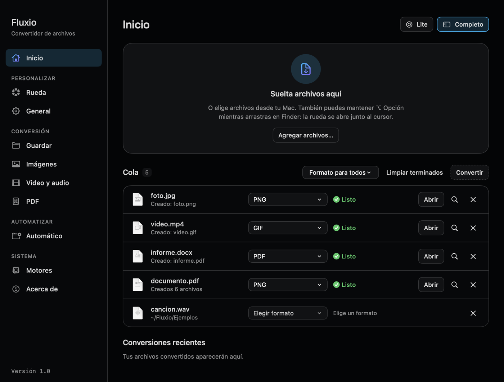
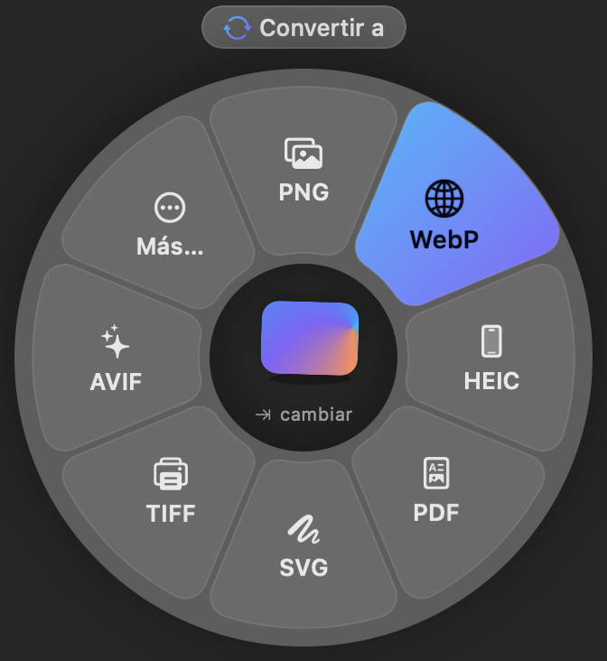
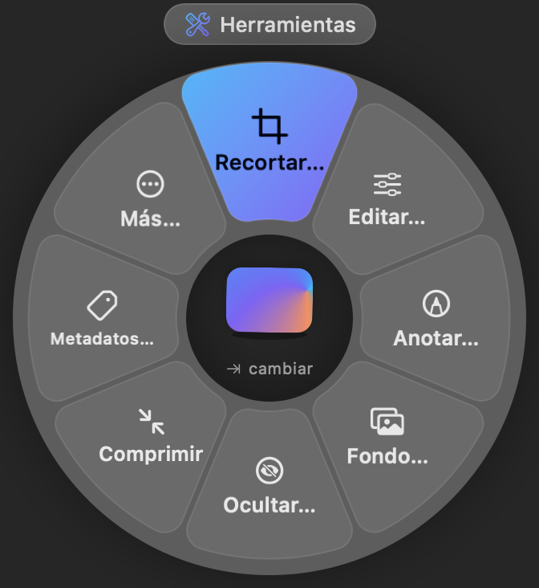
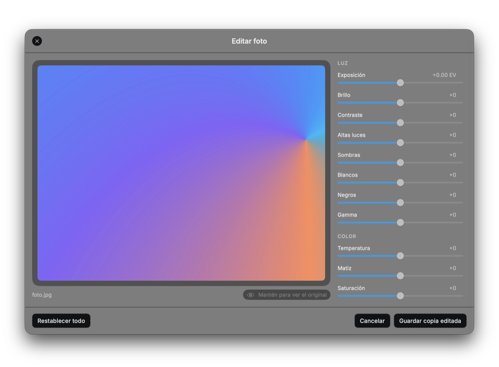
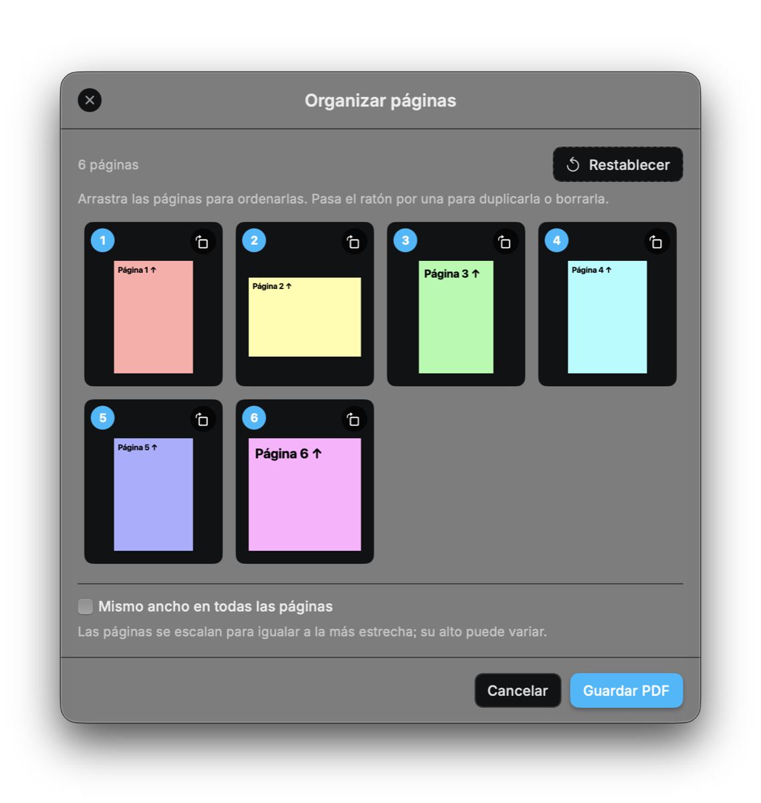
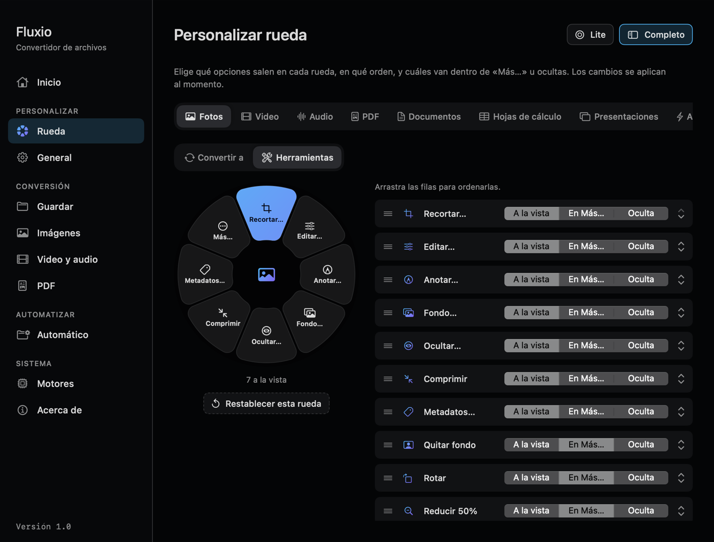
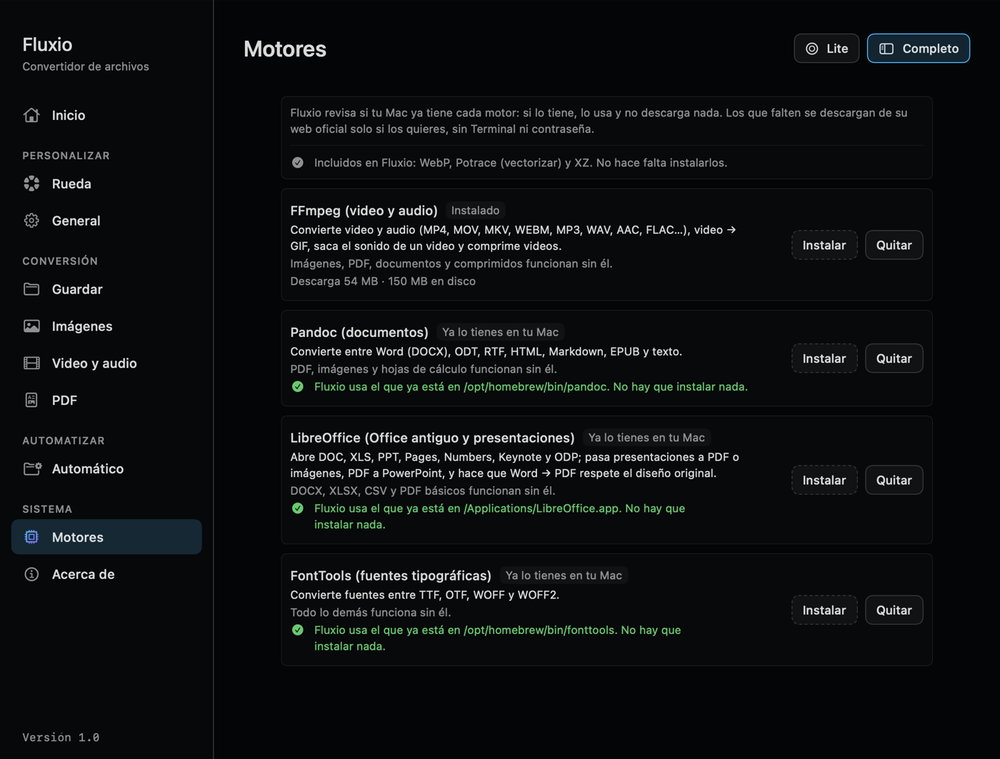
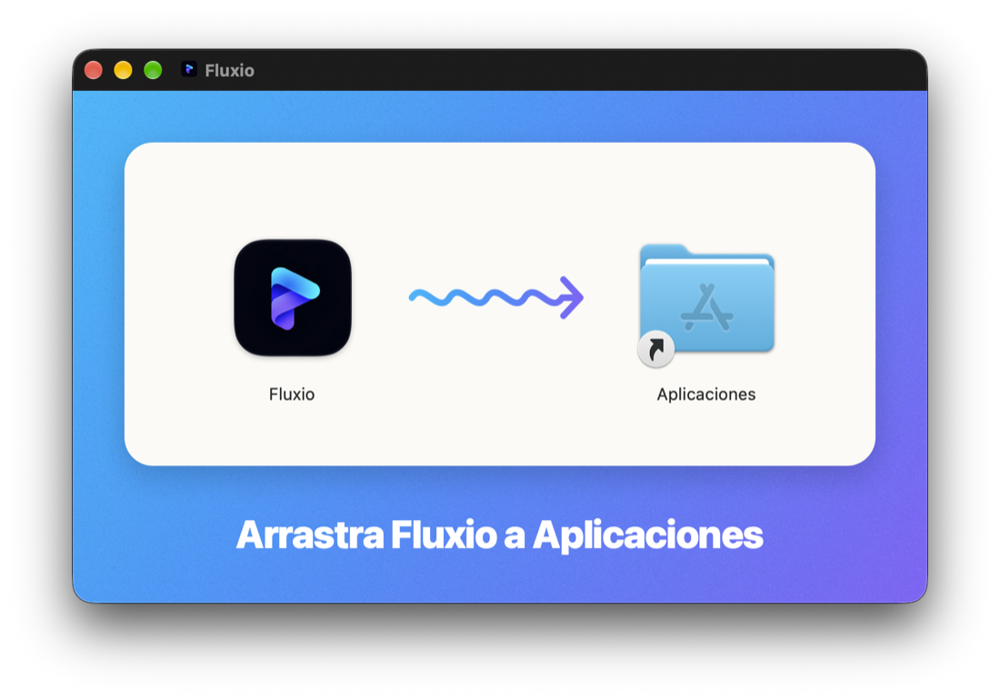

<p align="center">
  
</p>

<p align="center">
  <a href="https://github.com/RonaldRedondo/Fluxio/releases/latest/download/Fluxio.dmg"><b>⬇️ Descargar Fluxio para Mac</b></a>
  &nbsp;·&nbsp; Intel y Apple Silicon &nbsp;·&nbsp; macOS 13 o posterior &nbsp;·&nbsp; Gratis
</p>
<p align="center">
  <a href="https://github.com/RonaldRedondo/Fluxio/releases/latest/download/Fluxio-Setup.exe"><b>⬇️ Descargar Fluxio para Windows</b></a>
  &nbsp;·&nbsp; Windows 10 y 11 (64 bits) &nbsp;·&nbsp; Gratis
</p>

# Fluxio

Convertidor de archivos para Mac y Windows (versión 1.0), **100 % sin conexión**: tus archivos nunca salen de tu ordenador.
Arrastras un archivo a la ventanita flotante, aparece una rueda con opciones y sueltas sobre la que quieras.

## Míralo en 42 segundos

<p align="center">
  <a href="https://youtu.be/zZVqhSNILWA" title="Ver el video en YouTube">
    
  </a>
</p>
<p align="center"><em>Pulsa la imagen para ver el video en YouTube.</em></p>

## Así se ve

<p align="center">
  
</p>
<p align="center"><em>Modo Completo: agrega varios archivos, elige el formato de cada uno y conviértelos a la vez.</em></p>

<table>
  <tr>
    <td align="center" width="50%"><br><em>Arrastra un archivo: la rueda te ofrece a qué convertirlo.</em></td>
    <td align="center" width="50%"><br><em>Con ⌘ Cmd: recortar, editar, anotar, añadir fondo, ocultar…</em></td>
  </tr>
</table>

<table>
  <tr>
    <td align="center" width="60%"><br><em>Editar foto: luz, color y detalle con vista previa en vivo.</em></td>
    <td align="center" width="40%"><br><em>Organizar páginas: ordena, gira, duplica o borra páginas de un PDF.</em></td>
  </tr>
</table>

<p align="center">
  
</p>
<p align="center"><em>Personalizar rueda: elige qué opciones salen, en qué orden y cuáles van en «Más…».</em></p>

<p align="center">
  
</p>
<p align="center"><em>Motores: Fluxio detecta lo que ya tienes e instala el resto con un clic, sin Terminal.</em></p>

## ⬇️ Descargar

### Mac

Funciona en cualquier Mac con **macOS 13 (Ventura) o posterior**, con chip Apple (M1, M2, M3, M4…) o Intel.

**[⬇️ Fluxio.dmg](https://github.com/RonaldRedondo/Fluxio/releases/latest/download/Fluxio.dmg)**: un solo instalador para cualquier Mac.
Lleva dentro la versión para chip Apple y la versión para Intel, y cada Mac usa la suya.

<p align="center">
  
</p>

**Instalar:**
1. Descarga `Fluxio.dmg` y haz **doble clic** en él (en la carpeta Descargas). Se abre una ventana como la de arriba.
2. Arrastra **Fluxio** a la carpeta **Aplicaciones** y expulsa el disco «Fluxio» (en Finder, botón ⏏).
3. Haz doble clic en Fluxio. La primera vez macOS avisa que es de un **«desarrollador no identificado»**
   (Fluxio es gratuita y no está registrada con Apple) → pulsa **OK** o **Listo**.
4. Abre  → **Ajustes del Sistema** → **Privacidad y seguridad**, baja hasta el mensaje sobre Fluxio y pulsa
   **Abrir igualmente**; escribe la contraseña de tu Mac y pulsa **Abrir**. Solo hace falta la primera vez.
   (En macOS 13 y 14 también sirve: clic derecho sobre Fluxio → **Abrir** → **Abrir**.)
5. El icono de Fluxio aparece arriba a la derecha, en la barra de menú. Para video, Word, Office y fuentes,
   instala los motores con un clic en Ajustes → **Motores** (más abajo, apartado «Motores»).

### Windows

Funciona en **Windows 10 y 11 de 64 bits**.

**[⬇️ Fluxio-Setup.exe](https://github.com/RonaldRedondo/Fluxio/releases/latest/download/Fluxio-Setup.exe)**: el instalador para Windows.

**Instalar:**
1. Descarga `Fluxio-Setup.exe` y haz **doble clic** en él (en la carpeta Descargas). Se instala solo para tu
   usuario (no pide ser administrador) y Fluxio se abre al terminar.
2. Si Windows dice **«Windows protegió su PC»** (Fluxio es gratuita y no lleva firma digital) → pulsa
   **Más información** → **Ejecutar de todas formas**. Solo hace falta la primera vez.
3. Aparecen la tarjeta «Suelta aquí» y el icono de Fluxio en la bandeja (abajo a la derecha, junto al reloj). Para
   video, Word, Office y fuentes, instala los motores con un clic en Ajustes → **Motores**.

En Windows, las ruedas se cambian con **Shift** (Convertir), **Ctrl** (Herramientas) y **Alt** (Acciones). Además:
clic derecho en archivos o carpetas → **Convertir con Fluxio** (en Windows 11, dentro de «Mostrar más opciones»),
**Ctrl + Alt + F** con archivos elegidos en el Explorador, y el comando `fluxio` en la terminal
(`fluxio foto.heic a jpg`, `fluxio ayuda`). Se desinstala desde Configuración → Aplicaciones.

Todas las versiones: [Releases](https://github.com/RonaldRedondo/Fluxio/releases). Licencia: [MIT](LICENSE). Incluye herramientas de terceros con su propia licencia (WebP: BSD; Potrace: GPL v2; tipografía Inter: SIL OFL), ver [LICENSES.txt](Resources/Tools/LICENSES.txt).

---

## 1. Generar la app desde el código

Solo hace falta si quieres compilar Fluxio tú mismo (para usarla basta con «Descargar», arriba). Necesitas las
herramientas de línea de comandos de Apple: en Terminal, `xcode-select --install`.

### La primera vez (o después de cambiar algo)
1. Abre la app **Terminal** (búscala con ⌘ + Espacio y escribe "Terminal"). Si aún no tienes el proyecto,
   descárgalo con `git clone https://github.com/RonaldRedondo/Fluxio.git ~/Fluxio`.
2. Copia y pega esto, y pulsa Enter:

   ```bash
   cd ~/Fluxio && ./build_and_run.sh
   ```

3. Verás 4 pasos con ▶ y al final **✅ Listo**. Tarda ~1 minuto la primera vez.

### Las siguientes veces
Haz **doble clic** en `Fluxio/build/Fluxio.app`.
Consejo: arrástrala a tu carpeta **Aplicaciones** o al Dock para tenerla a mano
(si la recompilas, vuelve a copiarla).

### Crear el instalador para compartir

Después de `./build_and_run.sh`, este comando crea `build/release/Fluxio.dmg`, el instalador para cualquier Mac
(la primera vez, macOS pide permiso para que Terminal controle Finder: pulsa **Permitir**):

```bash
cd ~/Fluxio && ./Scripts/make_dmg.sh
```

### En otra Mac (paso a paso)

Funciona en cualquier Mac con macOS 13 (Ventura) o posterior, con chip Apple (M1, M2, M3, M4…) o Intel.
**Es la misma app para los dos**: `build_and_run.sh` la genera «universal» (lleva dentro la versión para chip
Apple y la versión para Intel, y cada Mac usa la suya). No hay que generar nada distinto para un Mac Intel.

Para saber qué chip y qué macOS tiene una Mac:  → **Acerca de esta Mac**. Donde dice **Chip** es Apple; donde
dice **Procesador** (Intel Core i5, i7…) es Intel. Debajo aparece la versión de macOS (13 o más).

1. En la Mac donde está el proyecto, crea el instalador con `./Scripts/make_dmg.sh` (queda `build/release/Fluxio.dmg`).
2. Pasa `Fluxio.dmg` a la otra Mac (AirDrop, USB o correo).
3. En esa Mac, haz **doble clic** en `Fluxio.dmg`, arrastra **Fluxio** a la carpeta **Aplicaciones** y expulsa el disco.
4. Abre **Terminal** (⌘ + Espacio, escribe "Terminal", Enter).
5. Copia y pega esto, y pulsa Enter (no muestra ningún mensaje: es normal):

   ```bash
   xattr -dr com.apple.quarantine /Applications/Fluxio.app
   ```

   Cuando un archivo llega de otra computadora, macOS lo marca como "descargado de internet" y, como Fluxio no está
   registrada con Apple, dice **"La aplicación Fluxio no se puede abrir"**. Este comando solo quita esa marca.
   Hace falta una vez por Mac.

   **Sin Terminal (otra forma):** abre Fluxio con doble clic; macOS dirá que no se puede abrir porque es de un
   «desarrollador no identificado» → pulsa **OK** (o **Listo**). Luego abre  → **Ajustes del Sistema** →
   **Privacidad y seguridad**, baja hasta el mensaje sobre Fluxio y pulsa **Abrir igualmente**; escribe tu
   contraseña de la Mac y pulsa **Abrir**. (En macOS 13 y 14 también sirve: clic derecho sobre Fluxio → **Abrir**
   → **Abrir**.)
6. Abre **Aplicaciones** → **Fluxio**. El icono aparece en la barra de menú. La primera vez, pulsa **Permitir**
   en los permisos que macOS pida.
7. En Ajustes de Fluxio → **Motores**, instala los motores que necesites: Fluxio descarga solo la versión para
   el chip de esa Mac (Intel o Apple).

### Motores: lo que algunos formatos necesitan (sin Terminal)

Imágenes (también WebP y SVG), PDF, hojas de cálculo, subtítulos y comprimidos funcionan sin instalar nada:
**WebP, Potrace y XZ ya vienen dentro de Fluxio**. Para video, documentos de Word, Office antiguo y fuentes hacen
falta unos programas más grandes, los **motores**:

1. Abre Ajustes de Fluxio → pestaña **Motores** (en el modo Completo, «Motores» en la barra lateral).
2. Fluxio **revisa solo si tu Mac ya tiene cada motor** (por ejemplo, instalado antes con Homebrew o LibreOffice
   en Aplicaciones). Si lo tiene, verás **«Ya lo tienes en tu Mac»** y no hay que hacer nada.
3. Si falta alguno y lo necesitas, pulsa **Instalar**. Se descarga de la web oficial del proyecto, se comprueba
   que llegó intacto y queda listo. No pide contraseña ni usa Terminal. **Quitar** lo borra.

| Motor | Para qué | Descarga |
|---|---|---|
| **FFmpeg** | Video y audio | ~55 MB |
| **Pandoc** | Word (DOCX), ODT, RTF, HTML, Markdown, EPUB | ~40 MB |
| **LibreOffice** | DOC, XLS, PPT, Pages, Numbers, Keynote; presentaciones a PDF; PDF a PowerPoint | ~285 MB |
| **FontTools** | Fuentes TTF, OTF, WOFF, WOFF2 | ~24 MB |

Si al convertir falta un motor, Fluxio te dice cuál instalar en Ajustes → Motores.

**Pandoc y macOS antiguo:** la versión actual de Pandoc pide macOS 15. En los Mac Intel con macOS 13 o 14, Fluxio
instala la 3.8.1, que funciona igual. En un Mac con chip Apple y macOS 13 o 14, la tarjeta dice **«No disponible
en tu macOS»**: actualiza macOS (gratis, todos los Mac con chip Apple pueden) en Ajustes del Sistema → General →
Actualización de software.

---

## 2. Cómo se usa

Fluxio vive en la **barra de menú** (arriba a la derecha, con el icono de Fluxio). En modo Lite no tiene icono en el Dock.

### Dos modos: Lite y Completo

| Modo | Cómo es | Para qué |
|---|---|---|
| **Lite** | La tarjeta flotante «Suelta aquí» y la rueda radial. | Convertir rápido: arrastras, eliges en la rueda y listo. |
| **Completo** | Una ventana con barra lateral, como una app normal (con icono en el Dock). | Gestionar varios archivos: ver la lista, elegir el formato de cada uno, ver el avance, abrir los resultados. |

**Cambiar de modo** (hay cuatro formas, todas hacen lo mismo):
- En la tarjeta «Suelta aquí», el **icono pequeño de arriba a la derecha** → modo Completo.
- En la ventana Completa, los botones **Lite** y **Completo** de arriba a la derecha (el del modo actual se ve marcado).
- El atajo **⌃⌥M** (Control + Opción + M), desde cualquier app.
- Menú de Fluxio → **Cambiar a modo Completo / Lite**.

La ventana se transforma en la otra con una animación corta. Si en **Ajustes del Sistema → Accesibilidad →
Pantalla** tienes activado **Reducir movimiento**, se hace un fundido simple. Fluxio recuerda el último modo
y lo abre al iniciar. Si cierras la ventana Completa con el botón rojo, Fluxio sigue en la barra de menú en modo Lite.

**Los dos modos comparten la misma lista de archivos**: lo que conviertes con la rueda aparece en el modo
Completo, y cambiar de modo nunca detiene ni borra las conversiones en curso.

### Modo Completo, paso a paso

1. **Agrega archivos:** suéltalos en la zona grande «Suelta archivos aquí» (o en cualquier parte de la página
   Inicio) o pulsa **Agregar archivos…** (también ⌘O).
2. **Elige el formato** de cada archivo en su menú (**Elegir formato**). Con **Formato para todos** pones el
   mismo a todos los que lo admiten. Fluxio recuerda el último formato que elegiste y lo propone a los nuevos.
3. Pulsa **Convertir todo** (o ⌘ + Enter). Cada fila muestra su estado: *En cola*, la barra de progreso con el %,
   **Listo**, **Error** (pasa el ratón para leer el motivo) o **Cancelado**.
4. Cuando termina: **Abrir** abre el resultado con su app, 🔍 lo muestra en Finder y ✕ lo quita de la lista
   (el archivo no se borra). Si algo falló, ↻ lo vuelve a intentar.
5. **Limpiar terminados** quita de la lista todo lo que ya acabó. Debajo están las **Conversiones recientes**.

En la barra lateral también están todas las secciones de **Ajustes** y **Acerca de**.

### Cuatro formas de abrir la rueda

| Cómo | Qué haces |
|---|---|
| **Junto al cursor** (la más rápida) | Arrastra archivos desde cualquier sitio (Finder, Escritorio, Mail…) **manteniendo ⌥ Opción**: la rueda aparece donde está el ratón. Suelta sobre una opción. Si sueltas fuera, no pasa nada. |
| **Clic derecho en Finder** | Selecciona archivos → clic derecho → **Convertir con Fluxio** (en "Acciones rápidas" o "Servicios"). |
| **Atajo ⌃⌥F** | Selecciona archivos en Finder y pulsa **Control + Opción + F**. La primera vez macOS pide permiso para que Fluxio "controle Finder": pulsa **Aceptar**. |
| **Ventana flotante** | Arrastra archivos a la tarjeta "Suelta aquí". |

> Si "Convertir con Fluxio" no aparece en el clic derecho: **Ajustes del Sistema → Teclado → Atajos de teclado →
> Servicios → Archivos y carpetas** y activa **Convertir con Fluxio**. La tecla ⌥ y el atajo se cambian o
> desactivan en Ajustes de Fluxio.

### Las tres ruedas

| Gesto | Qué pasa |
|---|---|
| Arrastra un archivo (con ⌥ o a la ventana flotante) | Aparece la **rueda de conversión** |
| …manteniendo **⇧ Shift** | Rueda de conversión (JPG, PNG, HEIC…) |
| …manteniendo **⌘ Cmd** | Rueda de **herramientas** (comprimir, reducir 50 %, quitar metadatos) |
| …manteniendo **⌃ Ctrl** | Rueda de **acciones** (AirDrop, Float, copiar, mover, copiar ruta, Terminal, Finder) |
| Suelta sobre una opción | Se ejecuta |
| Suelta en el **centro** | La rueda se queda abierta: elige con **flechas** y **Enter**, cambia de rueda con **Tab**, cierra con **Escape** |

**Personalizar la rueda:** en el modo Completo → **Rueda** eliges el tipo de archivo (Fotos, Video, Audio, PDF, Documentos, Hojas de cálculo, Presentaciones o Acciones) y la rueda (Convertir a / Herramientas). Ves la rueda en pequeño y la lista de opciones: arrástralas para ordenarlas y elige si van **a la vista**, **en «Más…»** u **ocultas**. Se aplica al momento; «Restablecer esta rueda» la deja como venía.

Encima de la rueda se ve en qué rueda estás («Convertir a», «Herramientas», «Acciones»; «· Más» dentro de «Más…»). Cada rueda tiene **como mucho 8 gajos**: 7 opciones y «Más…» con el resto (si no caben, hay otro «Más…» dentro; «‹ volver» regresa de uno en uno). Los títulos largos van en dos líneas.

En el centro de la rueda flota la **miniatura real del archivo** (con varios, un montoncito con el número) y se inclina hacia la opción que resaltas. El centro es transparente.

**Float (estante flotante):** en la rueda Ctrl, «Float» deja los archivos en una tarjeta que flota sobre todas las ventanas. Arrastra el montón (o un archivo de la lista, con «N archivos») a cualquier app, suelta más archivos encima, y si la acercas al borde de la pantalla se pega a él. Doble clic abre el archivo; la ✕ cierra el estante (no borra nada). **Copiar** copia los archivos para pegarlos con ⌘V en Finder.

- El resultado se guarda **junto al original** (por ejemplo `foto.jpg` → `foto.png`).
  Si ya existe, se llama `foto (1).png`. **El original nunca se toca.**
- Al terminar aparece una notificación con **Mostrar en Finder**.
- Si sueltas **varios archivos**, se convierten **varios a la vez** (hasta 4, según tu Mac). Si alguno falla,
  el resto termina igual y el mensaje dice cuáles fallaron.
- Menú de Fluxio → **Recientes**: las últimas 10 conversiones; haz clic en una para verla en Finder.
- Puedes mover la ventana flotante arrastrándola por su fondo. Se oculta/muestra desde el menú de Fluxio.
- **Sin ratón o con VoiceOver:** menú de Fluxio → **Elegir archivo…** (⌘O).

### Formatos: imágenes
Entrada: JPG, PNG, WebP, HEIC, TIFF, AVIF, BMP, GIF, PDF (y casi cualquier imagen que abra Vista Previa).
Salida: JPG, PNG, WebP\*, HEIC, TIFF, AVIF, BMP, PDF.
Un PDF de varias páginas se convierte en una imagen por página (`documento-pagina-1.png`, …).

\* **WebP** viene incluido en Fluxio.

### Formatos: audio y video
- **Audio** → MP3, M4A, WAV, FLAC, OGG, Opus, AIFF.
- **Video** → MP4, MOV, MKV, WebM, GIF animado, o **MP3 audio** (extrae solo el sonido).
- Entrada: además de los anteriores, casi cualquier video o audio (AVI, WMV, AAC…).
- Cuando es posible (por ejemplo MOV del iPhone → MP4), Fluxio **copia sin recodificar**: es instantáneo y sin pérdida de calidad.
- Los GIF se crean a 12 fotogramas por segundo y máximo 640 px de ancho, para que no pesen demasiado.
- Durante la conversión ves el **porcentaje** y puedes pulsar **Cancelar** (o Escape); no quedan archivos a medias.

Audio y video necesitan el motor **FFmpeg** (gratuito, funciona sin internet): Ajustes → **Motores** → Instalar.
Si ya lo tienes en tu Mac, Fluxio lo usa directamente.

### Formatos: documentos, hojas de cálculo, subtítulos y comprimidos

| Si sueltas… | Puedes convertir a… |
|---|---|
| **DOCX, Markdown, TXT, HTML, EPUB, ODT, RTF** | DOCX, Markdown, TXT, HTML, EPUB, **PDF** |
| **PDF** | JPG, PNG, TIFF (una imagen por página) · TXT, DOCX, Markdown, HTML (solo el texto) |
| **XLSX, CSV, TSV, ODS** | los otros tres |
| **SRT / VTT** (subtítulos) | VTT / SRT, o **Texto** (solo los diálogos) |
| **ZIP, TAR, TAR.GZ** | **Extraer**, o cambiar a otro de esos formatos |
| **.gz** | Extraer |
| **Una carpeta** | ZIP, TAR, TAR.GZ |

Y con **⌘ Cmd** (herramientas), cualquier archivo o carpeta se puede **comprimir** en ZIP, TAR.GZ o GZIP.
Como en Finder, `foto.jpg` se comprime en `foto.jpg.zip`.

Cosas a saber:
- Los documentos necesitan el motor **Pandoc** (gratuito, sin internet): Ajustes → **Motores**.
- **PDF → Word/texto** recupera solo el texto, no el diseño. Si el PDF es una imagen escaneada, no hay texto que sacar.
- Los **PDF que crea Fluxio** usan SF Pro y tamaño A4. Puedes cambiar fuente, tamaño, márgenes y colores en
  `DesignTokens.swift`, sección `DocumentPDF`.
- **CSV**: Fluxio detecta si las columnas van separadas por `,` o por `;` (como en el Excel en español).
  Los números como `007` se conservan como texto para no perder los ceros.
- **Excel con varias hojas → CSV**: se crea un CSV por hoja (`datos-Ventas.csv`, `datos-Gastos.csv`…).
- Las fórmulas de Excel se guardan con su **resultado**, no con la fórmula. Las fechas pueden aparecer como número.
- **Descomprimir**: si dentro hay una sola carpeta, aparece directamente esa carpeta (sin carpetas dobles).

### Formatos: vectores, fuentes y oficina

| Si sueltas… | Puedes convertir a… | Necesita |
|---|---|---|
| **Una imagen** (PNG, JPG…) | **SVG** vectorial, trazado a color (Ajustes → Imágenes → colores: 2 = blanco y negro, hasta 16) | Nada (incluido) |
| **Un SVG** | PNG, JPG o PDF (el PDF sigue siendo vectorial) | Nada |
| **Una fuente** (TTF, OTF, WOFF, WOFF2) | Las otras tres. TTF ↔ OTF convierte de verdad las curvas de cada letra | FontTools |
| **PowerPoint, Keynote u ODP** (PPTX, PPT, KEY, ODP) | PDF, PNG o JPG (una imagen por diapositiva), PowerPoint u ODP | LibreOffice |
| **Un PDF** | además, **PowerPoint** (cada página se vuelve una diapositiva editable) | LibreOffice |
| **DOC, Pages, WPD** | PDF, DOCX, ODT, TXT | LibreOffice |
| **XLS, Numbers** | XLSX, ODS, CSV, PDF | LibreOffice |
| **XLSX, ODS, CSV, TSV** | además, **PDF** | LibreOffice |

Con LibreOffice instalado, **Word / ODT / RTF → PDF** respeta el diseño original (tablas, imágenes, márgenes).

FontTools y LibreOffice se instalan con un clic en Ajustes → **Motores** (gratuitos, funcionan sin internet).

### Más formatos

Cuando una rueda tiene muchas opciones, las menos usadas se agrupan en el gajo **"Más…"**: suéltalo (o haz clic)
y la rueda se convierte en una segunda rueda. Toca el centro o pulsa **Escape** para volver.

| Tipo | Novedades |
|---|---|
| **Imágenes** | GIF, ICO (iconos de Windows), ICNS (iconos de Mac), JPEG 2000, TGA y PSD. Abre también RAW de cámara. **Quitar fondo** (rueda ⌘, macOS 14+): deja solo a la persona, animal u objeto, en PNG transparente |
| **Video** | AVI, APNG (como un GIF pero a todo color), **M4A audio** y **extraer subtítulos** (SRT) de un video. Abre WMV, FLV, MPG, TS, 3GP, VOB… |
| **Audio** | AAC y ALAC (sin pérdida de Apple). Abre WMA, AMR, APE, WavPack, AC3, DTS, CAF… |
| **Subtítulos** | ASS/SSA y LRC (letras de canciones), en los dos sentidos |
| **Comprimidos** | Extraer **7Z, RAR, ISO, DMG, CAB, TAR.BZ2, TAR.XZ, BZ2 y XZ**. Crear **7Z**, TAR.BZ2 y TAR.XZ |
| **Texto** | LaTeX, reStructuredText, Org, MediaWiki, AsciiDoc, Typst, Jupyter y Textile (entrada y salida), y además ODT y RTF de salida |
| **Datos** | Hojas de cálculo → **JSON** y **HTML**. JSON (lista de objetos) → XLSX, CSV, TSV, ODS. JSON ↔ **Plist** |
| **Cómics** | PDF ↔ **CBZ** |
| **3D** | OBJ ↔ STL ↔ PLY ↔ USD, y una **vista previa PNG** del modelo. Abre también USDZ y Alembic |

**PSD con capas editables:** al convertir a PSD, el archivo se abre en Photoshop con **capas normales** (no una
capa de fondo bloqueada), con su nombre y su transparencia:
- Una foto (JPG, PNG, HEIC…) → **personas y animales en su propia capa**, con el reconocimiento de imágenes de
  macOS (sin internet). Capas, de arriba abajo: carpeta **«Personas»** («Persona 1», «Persona 2»…, de izquierda
  a derecha), carpeta **«Animales»** (cada uno con su nombre: «Perro», «Cebra»…), **«Fondo»** (el resto de la
  imagen, con un **hueco transparente** donde estaban) y **«Original»** (la imagen completa, oculta). Cada capa
  está recortada a su tamaño, así el archivo pesa menos. Necesita macOS 14 o posterior.
  - Los objetos (muebles, coches, productos…) se quedan en «Fondo».
  - El hueco del fondo no se rellena: si mueves a alguien, rellénalo en Photoshop con *Relleno según el contenido*.
  - Si no hay personas ni animales (por ejemplo, una captura de pantalla), sale **una capa** con el nombre del archivo.
- Un **GIF animado** o un **TIFF de varias páginas** → **una capa por fotograma** («Fotograma 1», «Fotograma 2»…),
  con solo la primera visible. Como mucho 100 capas, para que el archivo no sea enorme.

### Herramientas — arrastra manteniendo **⌘ Cmd**

| Si sueltas… | Herramientas |
|---|---|
| **Una imagen** | **Recortar…** (abre una ventana), **Editar…** (luz, color y detalle), **Anotar…**, **Fondo…**, **Ocultar…**, **Metadatos…**, en «Más…»: **Quitar fondo**, **Rotar** 90°, **Comprimir** (JPG, HEIC, WebP, AVIF: menos calidad hasta que pese menos; PNG: 256 colores con tramado fino, como TinyPNG, conserva la transparencia; TIFF: sin pérdida), Reducir 50 %, Sin metadatos |
| **Un video** | **Cortar…** (abre una ventana), **Recortar…** (el encuadre), **Velocidad…** (0,25× a 4×, la voz conserva su tono), **Fotogramas…** (PNG a tamaño completo), **Dividir…** (cortes a mano o partes iguales), **Comprimir** (MP4, máx. 1920 px), **Sin audio**, **Metadatos…** |
| **Un audio** | **Cortar…**, **Normalizar…** (volumen objetivo en LUFS, margen y pico máximo; mide el volumen actual), **Canales…** (mono o estéreo y volumen de cada lado), **Pitido…** (tapa tramos con un pitido), **Onda** (imagen PNG de la onda con el degradado de Fluxio), **Comprimir** (WAV/AIFF → FLAC sin perder calidad; MP3/M4A/Opus → menos peso), **Metadatos…** |
| **Un PDF** | **Organizar…** (ordena las páginas arrastrándolas, gíralas, duplícalas o bórralas; opción «Mismo ancho en todas las páginas». Crea `documento-organizado.pdf`), **Comprimir** (como "Reducir tamaño" de Vista Previa), **Dividir** (un PDF por página, dentro de una carpeta), **Metadatos…** |
| **Varios PDF y/o imágenes** | **Unir en PDF**: antes se abre una ventana para elegir el orden (arrastra las filas o usa las flechas; «Ordenar por nombre» vuelve al de Finder) |
| **Varias fotos** | **Collage…**: una sola imagen con todas (cuadrícula, fila, columna o una destacada), lienzo 1:1, 16:9, 4:5 o 9:16, ancho final, rellenar o foto entera, espacio, esquinas, color de fondo y orden (arrastrando). Crea `foto-collage.jpg` |
| **Varios videos** | **Unir videos** en un MP4, con la misma ventana de orden. Mezcla MP4, MOV, MKV…; el primero marca el tamaño y los demás se encajan con bandas negras. Necesita FFmpeg |
| **Varios archivos cualesquiera** | **ZIP** o **TAR.GZ** con todos juntos (`Archivo.zip`, como Finder) |
| **Cualquier archivo o carpeta** | ZIP, TAR.GZ, GZIP |

**Editar foto:** vista previa en vivo con **Luz** (exposición, brillo, contraste, altas luces, sombras, blancos, negros, gamma), **Color** (temperatura, matiz, saturación, intensidad, tono) y **Detalle** (claridad, quitar neblina, nitidez, reducir ruido, grano, viñeta). Cada control y cada grupo se restablecen por separado; mantén pulsado **«Mantén para ver el original»** para comparar. **Guardar copia editada** crea `foto-editada.jpg` con el mismo formato y metadatos.

**Metadatos:** ve, busca, cambia o quita (⊖) la información que lleva dentro una foto, un PDF, un audio o un video; **Quitar todo** la borra de una vez. Se guarda una copia `-metadatos` sin perder calidad (en fotos, los píxeles quedan idénticos). Audio y video necesitan FFmpeg.

**Anotar:** flechas, rectángulos, elipses, lápiz, resaltador, texto, números (1, 2, 3…), lupa e imágenes encima, con 8 colores y grosor. **Mover** elige una anotación para arrastrarla, cambiarle color o grosor, o borrarla (⌫); ⌘Z deshace. Guarda `foto-anotada`.

**Fondo:** la foto sobre un degradado, un color liso o **otra imagen** (desenfocable), con margen, esquinas redondeadas, sombra y proporción (Auto, 1:1, 16:9, 4:5, 9:16). Guarda `foto-con-fondo`.

**Ocultar:** arrastra sobre la foto para tapar una zona con **color sólido** o **desenfoque**; muévela o cambia su tamaño por las esquinas. **Caras** y **Texto** las encuentran solas, sin internet. La copia (`foto-oculta`) se guarda sin metadatos.

Con **varios archivos**, todas las ventanas de un solo archivo (Recortar, Cortar, Editar, Metadatos, Anotar, Añadir fondo, Ocultar) se abren una tras otra («1 de 3»…); si cierras la ventana, los que faltan se saltan. Solo **Unir** y **Collage** trabajan con todos a la vez.

**Ventana de recorte:** arrastra el marco con degradado para moverlo y sus esquinas para cambiar el tamaño.
Arriba eliges la proporción (Libre, Original, 1:1, 4:3, 3:2, 16:9, 9:16, 4:5) y abajo ves el tamaño final en píxeles.
**Enter** recorta, **Escape** cancela. Si soltaste varias imágenes, se abren una tras otra para elegir la zona de cada una.

**Ventana de corte:** una sola línea de tiempo (con miniaturas si es video). Arrastra el **asa izquierda**
para elegir el inicio y la **derecha** para el fin; lo que queda fuera se oscurece. Haz clic o arrastra sobre la línea
para mover la posición de reproducción (línea blanca), y usa **Marcar inicio aquí** / **Marcar fin aquí** para
llevar un asa a ese punto exacto. **Probar corte** reproduce solo el tramo elegido. **Enter** corta.
Con VoiceOver, cada asa se ajusta de medio en medio segundo con las flechas arriba/abajo.

Si "Comprimir" no consigue reducir el tamaño, Fluxio te lo dice y no crea un archivo más grande.

---

## 3. Permisos de macOS

| Cuándo | Qué hacer |
|---|---|
| Notificaciones | La primera vez macOS pregunta → **Permitir**. Si dijiste que no: **Ajustes del Sistema → Notificaciones → Fluxio** → activar *Permitir notificaciones*. |
| "Fluxio quiere acceder a la carpeta Escritorio / Descargas / Documentos" | Pulsa **Permitir**: lo necesita para guardar el resultado junto al original. Se puede revisar en **Ajustes del Sistema → Privacidad y seguridad → Archivos y carpetas**. |
| AirDrop | Debe estar activado en el **Centro de control**. |

> Nota: como la app se firma localmente, cada vez que la recompilas macOS puede volver a preguntar
> por las carpetas. Es normal.

---

## 4. Ajustes

Menú de Fluxio → **Ajustes…** (⌘,). Están en pestañas:

| Pestaña | Qué puedes cambiar |
|---|---|
| **General** | La rueda junto al cursor (activarla y su tecla, ⌥ por defecto), el atajo ⌃⌥F, las teclas de cada rueda, notificaciones y ventana flotante. |
| **Guardar** | Dónde guardar: junto al original, en una **subcarpeta** junto al original (por defecto "Convertidos") o en una carpeta fija. **Nombre del archivo** con un patrón: `{nombre}`, `{formato}`, `{fecha}`, `{hora}` (ej. `{nombre}-{fecha}` → `foto-2026-10-18.png`). Sobrescribir o añadir "(1)". |
| **Imágenes** | Calidad de JPG/HEIC/AVIF/WebP. **Tamaño**: porcentaje, lado más largo o ancho fijo (las pequeñas no se agrandan). **Escala de grises**, **voltear** (espejo o de cabeza) y **conservar metadatos**. |
| **Video y audio** | **Resolución máxima** (2160p, 1080p, 720p, 480p), **códec** (igual que el original, H.264, HEVC o AV1), **calidad** (alta, equilibrada, archivo pequeño) y **calidad del audio** en kbps. |
| **PDF** | **Rango de páginas** (`1-3`, `1, 4, 7`, `5-`) para pasar a imágenes o texto y para dividir. **Resolución** al convertir páginas en imagen (72 a 300 ppp). |
| **Automático** | **Carpetas vigiladas** y el **comando `fluxio`** para Terminal (ver abajo). |

Todos los ajustes empiezan con valores que no cambian nada, así que Fluxio funciona igual que antes hasta que los toques.

### Carpetas vigiladas

Ajustes → **Automático** → **Añadir carpeta…**, y elige a qué formato convertir (por ejemplo, tu carpeta Descargas → JPG).

- Cada archivo **nuevo** que entre en esa carpeta se convierte solo; el resultado se guarda en su subcarpeta **"Convertidos"**.
- Lo que ya estaba dentro no se toca. Los archivos que no se pueden convertir a ese formato se ignoran.
- Fluxio espera a que el archivo termine de copiarse o descargarse (3 segundos sin cambios) antes de convertirlo.
- El interruptor de cada fila la pausa sin borrarla; **⊖** deja de vigilarla. Solo funciona mientras Fluxio está abierto.

### Comando `fluxio` en Terminal

Ajustes → **Automático** → **Instalar**. Crea un pequeño archivo en `/opt/homebrew/bin/fluxio` que llama a Fluxio. Después, en Terminal:

```bash
fluxio foto.heic a jpg
fluxio *.png a webp -o ~/Desktop
fluxio opciones video.mov
fluxio ayuda
```

- `opciones` muestra a qué formatos se puede convertir un archivo (los nombres cortos: `jpg`, `mp3`, `pdf`, `compress`…).
- `-o carpeta` guarda los resultados ahí; `--sobrescribir` reemplaza archivos con el mismo nombre. Lo demás se toma de Ajustes.
- Si mueves Fluxio.app a otro sitio, vuelve a Ajustes → Automático y pulsa **Reinstalar**. **Quitar** lo borra.

## 5. Cambiar colores, tamaños y tipografías (para diseñadores)

Fluxio sigue un sistema de diseño: tipografía **Inter** (incluida en la app, licencia libre OFL), rejilla de 8 pt,
radios de 6/8/16/20 pt, bordes finos y botones sin sombra interior con texto de contraste ≥ 4,5:1. Los dos
modos (Lite y Completo) usan las mismas piezas, así que un cambio se ve en toda la app.

Todo el estilo está en **un solo archivo**:

```
Fluxio/Sources/Fluxio/Design/DesignTokens.swift
```

Ábrelo con **Editor de Texto** (o cualquier editor). Está comentado en español. Ejemplos:

| Quiero cambiar… | Busca | Ejemplo |
|---|---|---|
| El color de acento (cian) | `static let accent` | `light: 0x00B9FD` → `light: 0x7C5CFF` (violeta) |
| El segundo color del degradado (violeta) | `static let accentEnd` | `0x8363FB` → otro color; el degradado se actualiza solo |
| El tamaño de la rueda | `outerRadius` / `innerRadius` | `150` → `170` |
| La separación entre gajos | `sliceGap` | `4` → `2` |
| La fuente de los gajos | `sliceLabel` | `.bold` → `.heavy`, `design: .rounded` → `.default` |
| El redondeo de las tarjetas | `Radius.card` | `22` → `14` |
| El redondeo de los gajos de la rueda | `Radius.slice` | `12` → `20` (más redondo) o `0` (en punta) |
| Lo "elástica" que es la animación | `dampingFraction` | `0.72` (más rebote) → `0.9` (más seca) |

Los colores van en hexadecimal como en Figma, pero escritos `0x` + 6 dígitos.
Cada color tiene versión **light** (modo claro) y **dark** (modo oscuro).

Después de guardar, vuelve a ejecutar en Terminal:
```bash
cd ~/Fluxio && ./build_and_run.sh
```

**Icono de la app:** reemplaza `Fluxio/Resources/Fluxio-logo.png` por tu diseño (cuadrado, fondo incluido),
borra `Fluxio/Resources/AppIcon.icns` y recompila. El script crea solo el icono de la app con la forma
redondeada de macOS.

**Icono de la barra de menú:** reemplaza `Fluxio/Resources/MenuBarIcon-logo.png` por tu diseño (líneas o formas
sobre **fondo transparente**; el color no importa) y recompila. Se recorta, se reduce a 18 pt y macOS lo pinta en
blanco o negro según el tema. Las líneas se engordan un poco para que se vean a ese tamaño.

---

## 6. Si algo falla

- Si `build_and_run.sh` muestra ❌, el detalle queda en `build/compilacion.log`. Pásaselo a Claude.
- Si la app no aparece en la barra de menú, puede estar oculta por falta de espacio (muchos iconos).
  Prueba a cerrar alguna otra app de la barra.

---

## Para desarrolladores (resumen técnico)

- Swift + SwiftUI/AppKit, Swift Package Manager, sin Xcode. `build_and_run.sh` arma el `.app` y lo firma ad-hoc.
- `Engine/Converter.swift`: protocolo `Converter`. Los conversores se registran en `ConversionEngine.init`.
- `Engine/Image/`: ImageIO + PDFKit. WebP vía `cwebp` (`ExternalTool`, sin red): se le pasa un PAM RGBA, así
  `Resources/Tools/cwebp` se compila sin libpng/libjpeg (universal, macOS 13+, ver `LICENSES.txt`).
- `Engine/Media/`: ffmpeg/ffprobe vía `Process`; recetas en `FFmpegRecipes`, progreso con `-progress pipe:1`.
- `Engine/Documents/`: pandoc (documentos), HTML→PDF con `NSTextView` + `NSPrintOperation` (sin LaTeX), XLSX/ODS leídos y escritos a mano (XML + zip/unzip del sistema), subtítulos en Swift puro, comprimidos con ditto/tar/gzip.
- `UI/`: `FloatingPanel` (NSPanel + destino de arrastre), `DropCoordinator` (estado), `RadialWheelView`.
- Herramientas con ventana: `WheelOption.editor` (`EditorKind.crop/.trim`) → `EditorPresenter` → parámetros en `JobContext.parameters`. Operaciones de grupo: `Converter.options(for files:)` + `runBatch`.
- Rueda junto al cursor: `CursorWheelController` (monitor global de ratón + `NSPasteboard(name: .drag)`), servicio de Finder `FinderService` (NSServices en Info.plist), atajo `GlobalHotKey` (Carbon) y `FinderSelection` (AppleScript). Motor en paralelo: `ConversionEngine.parallelLimit`.
- Gajo "Más…": `WheelOption.secondary` / `children`, agrupado en `ConversionEngine.fold` (máx. 8 gajos).
- Nuevos conversores: `DataConverter` (JSON ↔ plist), `ComicConverter` (CBZ), `ModelConverter` (ModelIO + SceneKit), `BackgroundRemover` (Vision).
- Vectores: `VectorConverter` + `Tracer` (k-means + potrace por capa apilada). Fuentes: `FontConverter` (script fontTools). Oficina: `OfficeConverter` + `LibreOffice` (soffice --headless, perfil propio, de uno en uno).
- Ajustes de conversión: `Engine/ConversionOptions.swift` (`ImageOptions`, `MediaOptions`, `PDFOptions`, `NamingOptions`), viajan en `OutputPolicy`.
- Automatización: `Services/WatchedFolders.swift` (`WatchRule` en `AppSettings.watchRules`, `FolderWatcher` con `DispatchSource` + espera a tamaño estable, `TerminalCommand`), `App/CommandLineTool.swift` (`Fluxio --cli …`) y `Engine/OptionFinder.swift` (buscar una opción por formato).
- Sistema de diseño: `Design/DesignTokens.swift` (único archivo de tema: colores, espaciado, radios, bordes, tipografía `Typography.Style`, sombras, estados, animaciones), `Design/Fonts.swift` (Inter variable registrada al arrancar, ejes wght/opsz) y `Design/Components.swift` (`textStyle`, `card`, `keySurface`, `FluxioButtonStyle` primario/secundario/fantasma, `Badge`, `fluxioTheme`). Sin `@State` (necesita Xcode): estado en `ObservableObject` + `@StateObject`.
- Objetos en capas: `Engine/Image/ObjectLayers.swift` (Vision `VNGenerateForegroundInstanceMaskRequest`: una capa por instancia, «Fondo» con huecos y bordes rellenados con el color de alrededor, «Original» oculta).
- PSD con capas: `Engine/Image/PSDWriter.swift` (formato completo de Adobe: capas RGBA con nombre Unicode `luni`, visibilidad, perfil sRGB, PackBits e imagen combinada). macOS solo escribe PSD aplanados.
- PSD por capas: `Engine/Image/ObjectLayers.swift` (Vision: personas y animales, carpetas y capas recortadas; fondo con hueco transparente).
- Comprimir PNG: `Engine/Image/PNGQuantizer.swift` (paleta por corte de la mediana, tramado Floyd–Steinberg, PNG de paleta propio con zlib de Compression).
- Motores: `Engine/Engines/Engines.swift` (catálogo con URL oficiales y SHA-256, detección de copias del Mac, instalación en `~/Library/Application Support/Fluxio/Motores`) y `UI/EnginesView.swift`. WebP y Potrace van en `Resources/Tools` (ver `LICENSES.txt`); XZ usa el framework Compression. `Fluxio --enginetest estado|<motor>` prueba la instalación (con `FLUXIO_ENGINES_DIR` en otra carpeta).
- Memoria: `Resources/Info.plist` lleva `LSEnvironment` → `MallocLargeCache=0` (y el comando `fluxio` hace `export MallocLargeCache=0`). Sin eso, macOS guardaba los bloques grandes ya liberados y 20 fotos de 24 MP a PSD llegaban a 4,9 GB (ahora 1,9 GB), sin cambiar la velocidad.
- PSD y memoria: `PSDWriter` escribe directo al archivo (sin copias del bloque de capas) y reutiliza los píxeles de la capa única para la imagen combinada; `ObjectLayers` convierte cada sujeto en su capa recortada en cuanto lo reconoce (no guarda las siluetas a tamaño completo), lee las siluetas de personas solo si hay una persona y hace el fondo sobre los mismos píxeles. Mismo PSD byte a byte.
- Redibujos: `ConversionQueue.Item` es `Equatable` y `QueueRow` es una vista `.equatable()` que no vigila la cola ni el modelo (solo los usa en botones): cada fila se redibuja solo cuando cambia su archivo. 20 fotos grandes: 1.921 → 517 redibujos.
- Micro interacciones (modo Lite): piezas en `Design/Motion.swift` (transiciones `.blurScale` y `.toast`, `DrawnCheckmark`, `.shakeOnAppear()`, `.rollingDigits`, `ViewState` en lugar de `@State`) con tiempos en `DesignTokens.Motion`; `Services/FileDragWatcher.swift` avisa cuando arrastras archivos por la pantalla (la tarjeta invita a soltar) sin permisos ni gasto en reposo. Con «Reducir movimiento», solo fundidos.
- Micro interacciones (modo Completo): en la barra lateral el resaltado aparece en su sitio (crece desde `navSelectScale`, sin deslizarse ni dejar rastro), el icono da un salto y la fila se hunde al pulsar (los botones Lite | Completo no se deslizan: son botones, no un interruptor), las filas de la cola entran escalonadas (`.staggeredRowAppear()`) y salen con `.blurScale`, el estado cambia con desenfoque y «Listo» dibuja su check, el contador da un salto, «Convirtiendo…» lleva `.shimmer()` y al terminar `ScrambleText` barre la línea hasta «Creado: …»; en Motores, la instalación termina en check con «Listo para usar». El brillo y el barrido solo existen mientras se ven (0 % de procesador en reposo).
- Rueda: `UI/FloatingFileStack.swift` pone en el centro la miniatura de Quick Look (`QLThumbnailGenerator`, guardada en caché) que sube y baja con `TimelineView` solo mientras la rueda se ve, y se desplaza y ladea hacia el gajo resaltado; el fondo de la rueda es un anillo (`Ring`, regla par-impar) con el centro transparente. Tiempos y tamaños en `DesignTokens.Motion.float*` y `DesignTokens.Wheel.thumb*`. Las teclas de la tarjeta (⇧ ⌘ ⌃ ⌥) son símbolos SF (`Modifier.symbol`) para que queden centradas con el texto.
- Acciones: `Services/FileActions.swift` añade «Copiar» (las URL al portapapeles, como ⌘C en Finder) y «Float», que abre `UI/Shelf.swift`: `ShelfController` lleva los estantes (ventanas `ShelfWindow`, flotantes y sin activar la app), `ShelfView` muestra el montón (`FloatingFileStack` quieto) y la lista; `FileDragSource` arrastra los archivos fuera con `NSDraggingSession`, `WindowDragArea` mueve la tarjeta y al soltarla cerca del borde se pega (`snapToEdge`). La ventana deja `Shelf.shadowMargin` alrededor para que la sombra no se corte.
- Ventanas de herramientas: `UI/Editors/ToolWindow.swift` es el molde común (`makeToolWindow` + `ToolWindowView`: cabecera con ✕ y título, contenido y pie, vidrio oscuro) y `FileThumbnailView`. `UI/Editors/OrderEditor.swift` (`EditorKind.order`) elige el orden con flechas o arrastrando (`DragGesture` en coordenadas globales; puesto y desplazamiento se animan juntos); devuelve `ordered = 1` y los archivos ordenados. `MediaToolsConverter.runBatch` une videos con `concat` de FFmpeg (escala y bandas al tamaño del primero, silencio para los clips mudos).
- Editar foto: `Engine/Image/PhotoAdjustments.swift` (los 19 ajustes con Core Image: curva de tonos para negros/sombras/altas luces/blancos, `unsharpMask` de radio grande para claridad y neblina, grano con `CIRandomGenerator`…; `PhotoRenderer.context` compartido). La ventana (`UI/Editors/PhotoEditor.swift`, `EditorKind.photoEdit`) calcula la vista previa en segundo plano sobre una copia de 1.400 px; el motor aplica lo mismo a tamaño completo (`ImageToolsConverter`, herramienta `edit`).
- Metadatos: `Engine/MetadataTools.swift` (`MetadataReader` lee fotos con ImageIO, PDF con PDFKit y audio/video con ffprobe; `MetadataToolsConverter` escribe la copia: fotos con `CGImageDestinationCopyImageSource` sin recomprimir, PDF con `documentAttributes`, audio/video con `ffmpeg -c copy -metadata`). Los cambios de texto viajan al motor con un número (`MetadataEditStore`). Ventana: `UI/Editors/MetadataEditor.swift`. `EditorKind.isPerFile` abre estas dos ventanas una tras otra con varios archivos (`DropCoordinator.editOneByOne`).
- Anotar, fondo y ocultar: `Engine/Image/ImageMarkup.swift` (modelos en coordenadas 0…1 con y hacia abajo y un solo dibujo con AppKit, igual en pantalla y al guardar: `MarkupRenderer`, `BackgroundStyle`, `RedactionPlan` con detección de Vision). Lo elegido viaja al motor con `ToolPayloadStore`. Ventanas: `UI/Editors/AnnotateEditor.swift` (lienzo `NSView` con las herramientas), `BackgroundEditor.swift` y `RedactEditor.swift`. `EditorKind.isPerFile` abre todas las ventanas de un archivo una tras otra (Recortar y Cortar incluidos); solo «Unir» trabaja con todos a la vez.
- Collage: `Engine/Image/Collage.swift` (`CollageLayout` calcula las celdas y dibuja; `CollageRequest` lleva el diseño y el orden al motor, `ImageToolsConverter.runBatch`). Ventana: `UI/Editors/CollageEditor.swift`, que reutiliza la lista de orden (`OrderListView`).
- Rueda: `ConversionEngine.fold` reparte cualquier lista en ruedas de `maxSlices` (8) con «Más…» anidado (`DropCoordinator.parentStack`); la rueda de acciones también. Títulos de los gajos en dos líneas (`Wheel.labelSideInset`, `labelMinScale`). La ventana de la rueda tiene una franja de `Wheel.categoryBand` encima para la categoría (`PanelRootView.categoryLabel`); el centro de la rueda está en el cuadrado de abajo (`DropView.center`).
- Herramientas de video: `UI/Editors/VideoToolsEditors.swift` (`VideoPreviewModel` común con reproductor y paso de fotograma; ventanas Velocidad, Fotogramas y Dividir) y `MediaToolsConverter` (`setpts` + `atempo` encadenado, fotogramas con `ffmpeg -ss`, partes recodificadas, `crop` con `VideoCanvas`). Recortar el encuadre usa `CropModel(videoURL:)`.
- Personalizar rueda: `Engine/WheelCustomization.swift` (`WheelCategory`, `WheelLayout` guardado en `AppSettings.wheelLayouts`, `WheelCustomizer.apply` antes de `fold`; `WheelOption.inMore` fuerza «Más…»). Página: `UI/Full/WheelCustomizePage.swift` con `WheelPreview` y pestañas `SlidingTabs` (`Design/Components.swift`, una sola pastilla con `matchedGeometryEffect`). Icono propio de la rueda: `WheelGlyph`. La barra lateral va por grupos (`FullPage.groups`).
- Herramientas de audio: `Engine/Media/AudioTools.swift` (filtros `loudnorm`, `pan` y `aeval`; picos de la onda y volumen medido con FFmpeg; vistas previas de 30 s) y `UI/Editors/AudioToolsEditors.swift` (`WaveformView`, ventanas Normalizar, Canales y Pitido). La imagen de la onda: `showwavespic` + `WaveformPainter`.
- Organizar PDF: `Engine/Documents/PDFOrganize.swift` (`PDFOrganizePlan` viaja con `ToolPayloadStore`; sin «mismo ancho» copia las páginas con su giro y conserva texto y enlaces; con él las redibuja vectoriales con `CGPDFPage.getDrawingTransform`). Ventana: `UI/Editors/OrganizePDFEditor.swift` (cuadrícula `LazyVGrid`, arrastrar en 2D con `OrganizeModel.drag`, miniaturas en segundo plano).
- Cola compartida: `Engine/ConversionQueue.swift` (elementos con formato/estado/avance/resultados; trabajos en orden; `submit` desde la rueda, `convert`/`convertAll` desde el modo Completo). `ConversionEngine.Outcome.perFile` y `onFileProgress` dan el resultado y avance por archivo.
- Modo Completo: `UI/Full/FullModeView.swift` (barra lateral, Inicio, cola, recientes, Ajustes embebidos vía `SettingsView.page(_:)`, Acerca de) y `UI/Full/FullModeWindow.swift`. Logo de texto: `Scripts/make_wordmark.swift` → `Resources/Wordmark/`.
- Cambio de modo: `App/ModeSwitcher.swift` (recuerda `interfaceMode`, ⌃⌥M con `GlobalHotKey.modeSwitch()`) y `UI/WindowMorph.swift` (fotos de las dos ventanas en una ventana temporal; Core Animation anima bounds, posición, esquinas y opacidad; fundido con "Reducir movimiento"). La ventana de destino se coloca activa e invisible al empezar (`FullModeWindowController.showInvisible`, `animationBehavior = .none`), la animación la mueve `FrameDriver` fotograma a fotograma (curva `CubicBezier`), la ventana real aparece debajo en los últimos 0,1 s y la animación se desvanece 0,08 s sobre ella: sin saltos al final.
- Instalador: `Scripts/make_dmg.sh [carpeta]` crea `Fluxio.dmg` (por defecto en `build/release`). El fondo lo dibuja `Scripts/make_dmg_background.swift` (1x y 2x, juntos en un TIFF); Finder coloca los iconos por AppleScript (la primera vez macOS pide permiso para controlar Finder).
- Pruebas sin interfaz: `--queuetest <carpeta> <imagen1> <imagen2> <video>`, `--morphtest <carpeta>`, `--snapshot-full <carpeta> <archivos…>`, `--fonttest`, `--watchtest <carpeta> <archivo>`, `--optionstest <carpeta> <imagen> <video> <pdf>`, `--paralleltest <opción> <carpeta> <archivos…>`, `--selftest <archivo> <carpeta>`, `--batchtest <carpeta> <archivos…>`, `--canceltest <video> <carpeta>`, `--snapshot <carpeta> <archivo>`, `--snapshot-editors <carpeta> <imagen> <video>`.
